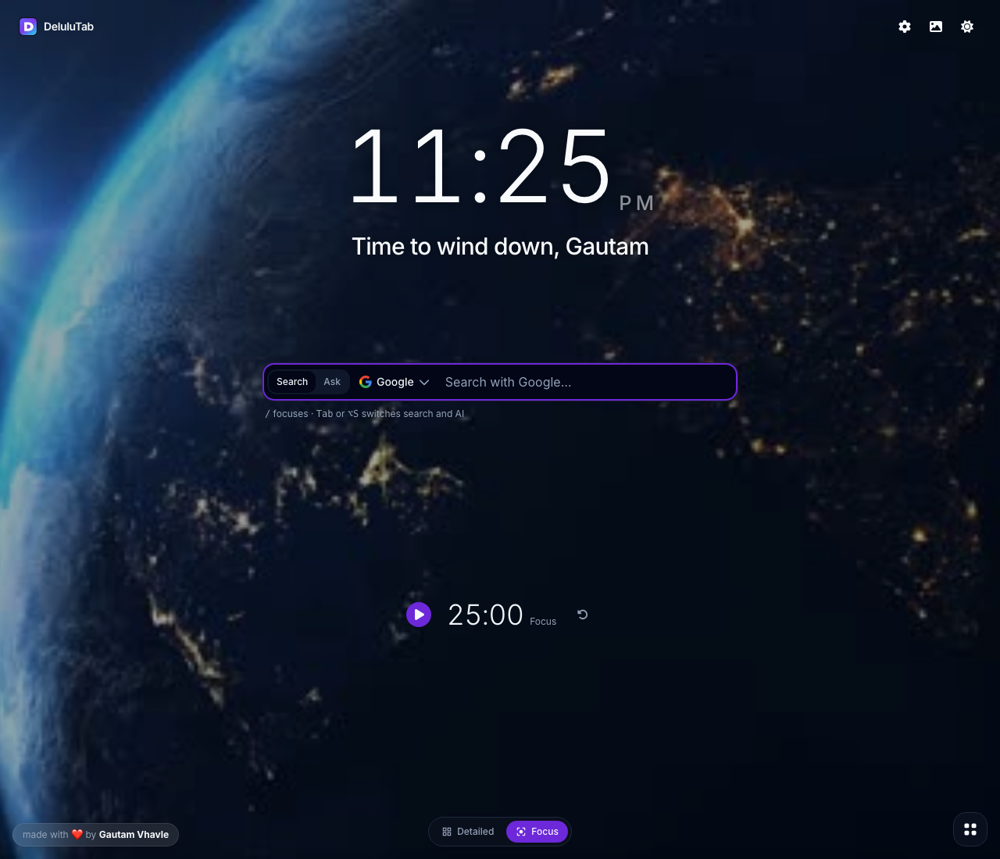
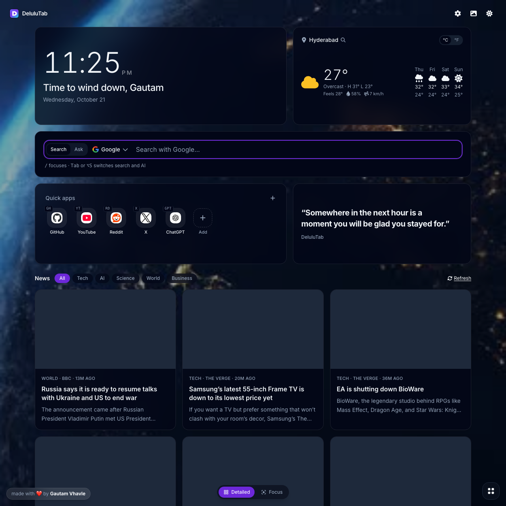

<p align="center">
  
</p>

<h1 align="center">DeluluTab</h1>

<p align="center">
  <strong>A calm new tab for Chrome and Brave.</strong><br />
  Search or ask an AI from one bar, jump anywhere with a chord, and keep the rest of the dashboard on your own device.<br />
  Not listed in the Chrome Web Store. Firefox is planned, not built yet.
</p>

<p align="center">
  <a href="https://github.com/GautamVhavle/DeluluTab/actions/workflows/ci.yml"></a>
  <a href="LICENSE"></a>
  
  
  
  
</p>

<p align="center">
  <a href="https://delulutab-preview.vercel.app"><strong>Open the live preview</strong></a>
</p>

<p align="center">
  
</p>

<p align="center">
  
</p>

<p align="center">
  <sub>Focus, then Detailed. Night earth behind both. The greeting is Gautam. The weather city is Hyderabad.</sub>
</p>

---

## Features

- **Search and Ask** share one bar. `/` puts the cursor there. Search opens Google, DuckDuckGo, Bing, Brave or Perplexity. Ask opens ChatGPT, Claude, Grok, Gemini or Perplexity. DeluluTab never sees the reply.
- **Chords.** Press `` ` ``, then a short code. `gh` opens GitHub, `yt` YouTube, `rd` Reddit, `x` opens X, `gpt` opens ChatGPT.
- **Clock.** The greeting sits under the time. Weight runs from the lightest face to the boldest, and the seconds belong to the clock instead of sitting beside it.
- **Weather.** The first visit asks the browser for your location and saves that city.
- **Backgrounds.** A colour, with fade or breathe, a gradient, a live scene, or your own image, video or GIF. The first visit plays Night earth. Under Uploads, an https picture or JSON with a `url` works too.
- **Dashboard.** **Detailed** is the full page. **Focus** keeps the clock, the search bar and the timer. Turning a widget off closes the gap.
- **Optional cards.** GitHub, tab stash, news, quotes, Spotify, a focus timer, and widgets you write yourself. They stay off until you turn them on.
- **On this device.** Notes, tasks, uploaded wallpapers and a JSON backup. What can leave the browser is listed in [PRIVACY.md](PRIVACY.md).

## How to use

Open a new tab. It opens in **Focus**: the clock, the search bar and, once you turn it on, the timer. **Detailed** is the full dashboard, one tap on the switch at the bottom. The first visit greets **Cat** and plays **Night earth**. On Detailed, **Use my location** asks the browser for your city. The name, the scene and the city can all be changed afterwards.

| Key | What it does |
| --- | --- |
| `/` | Put the cursor in the search bar |
| `Tab` in the bar, or `Alt+S` (`⌥S`) | Switch Search and Ask |
| `` ` ``, then a code | Open the matching shortcut |
| `Esc` | Cancel a chord |

Change the chord trigger and the codes in **Settings → Chords**.

**GitHub.** Turn the card on and enter a username. It stays on this device. The card shows that person's name, city, contribution graph and recent pushes. No token.

**Tab stash.** Start a list and add, rename or remove links. Restore opens them together. In the installed extension, **Save open tabs** can also capture the window you are in.

**Everything else** lives in Settings: appearance, clock, quotes, a JSON backup, and the tab title. Notes and tasks stay in the quick-apps drawer.

## Install

There is no store listing. You load the unpacked extension.

**Chrome**

1. Download [the latest release](https://github.com/GautamVhavle/DeluluTab/releases/latest) and unzip it, or build `dist/` yourself (below).
2. Open `chrome://extensions`.
3. Turn on **Developer mode**.
4. Choose **Load unpacked** and select the unzipped folder (or `dist/`).
5. Open a new tab.

**Brave**

The same steps, at `brave://extensions`. Brave runs this Manifest V3 package the same way Chrome does. If Shields blocks a feed or a photo, allow DeluluTab for that page.

Brave and Chrome draw their own bar under the new tab. It shows the extension name and **Customize**. An extension cannot hide that bar. Right-click it and choose **Hide footer on New Tab page**. The page then fills the window, and the controls sit on the bottom edge.

**Firefox**

Not yet. The extension uses Chrome's Manifest V3 service worker and `chrome.*` APIs. A Firefox build needs its own manifest and a pass over those calls. That work is later, on purpose.

After a new build, press the reload icon on the extension card.

### Build it yourself

```bash
git clone https://github.com/GautamVhavle/DeluluTab.git
cd DeluluTab
npm install
npm run build
```

Then load `dist/` as above.

```bash
npm run dev          # the UI at http://localhost:5173, stored in localStorage
npm run typecheck    # strict TypeScript, including unused code
npm test             # unit tests
npm run e2e          # Playwright against the production build
npm run package      # build, verify, and zip → release/DeluluTab-v<version>.zip
```

`npm run dev` is the page, not the extension. Saving the browser's open tabs, Spotify sign-in, and the focus-timer notification need the installed extension.

## What it is made of

| | |
| --- | --- |
| Extension | Manifest V3, Chrome and Brave |
| UI | React 18, TypeScript, Tailwind |
| State | Zustand. Settings sync. Notes, stashes and custom widgets stay on the device |
| Motion | Framer Motion |

The release checklist is [RELEASING.md](RELEASING.md).

## Contributing

1. Fork the repository and branch from `main`.
2. `npm install`, then `npm run dev`.
3. Keep the change small. A widget belongs in `src/components/widgets`, a request in `src/services`.
4. `npm run typecheck` and `npm test` must pass. Run `npm run e2e` when the change is something a person can see. Those are the same checks [CI](https://github.com/GautamVhavle/DeluluTab/actions/workflows/ci.yml) runs.
5. Open a pull request that says what changed and how you checked it.

Please open an issue before a large redesign. Bug fixes and small improvements are welcome as they are.

## Star

If DeluluTab is the new tab you wanted, star the repository. It helps the next person find it.

[Leave a star](https://github.com/GautamVhavle/DeluluTab/stargazers)

## License

MIT. Copyright (c) 2026 Gautam Vhavle. The full text is in [LICENSE](LICENSE).
